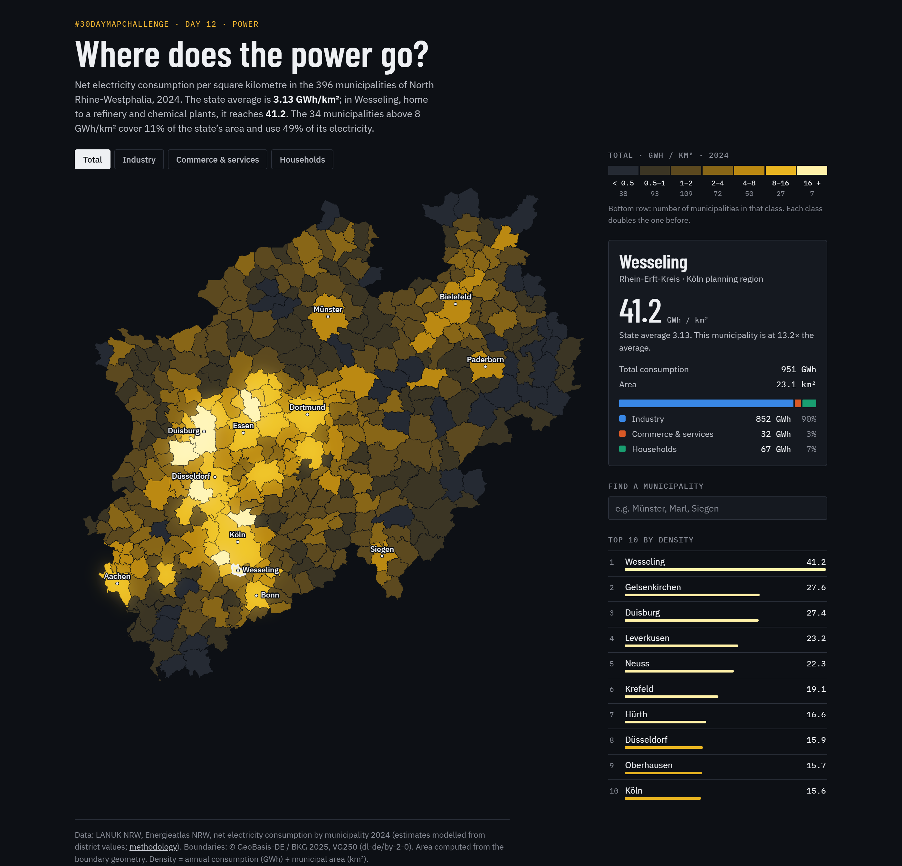

# nrw-power-density-map

**#30DayMapChallenge 2026 · Day 12 · Power**

Repository: [github.com/hasanemirbicen-dotcom/nrw-power-density-map](https://github.com/hasanemirbicen-dotcom/nrw-power-density-map) · Author: [@hasanemirbicen-dotcom](https://github.com/hasanemirbicen-dotcom)

Live map (once GitHub Pages is enabled): https://hasanemirbicen-dotcom.github.io/nrw-power-density-map/

Where does the power go? Net electricity consumption per square kilometre in the 396 municipalities of North Rhine-Westphalia (Germany), 2024.

## What the map shows

- The state average is **3.13 GWh/km²**.
- Wesseling, home to a refinery and chemical plants, reaches **41.2 GWh/km²**, about 13 times the average.
- The 34 municipalities above 8 GWh/km² cover 11% of the state's area and use 49% of its electricity.
- Switching between industry, commerce & services and households shows that the peaks along the Rhine and Ruhr are driven by industry, while household demand simply follows population.

## Files

| Path | Contents |
|---|---|
| `index.html` | The interactive map. Self-contained: data and boundaries are embedded, only the web fonts load from Google Fonts. |
| `images/nrw-power-density-dark.png` | Static image, dark theme (2800 px wide). |
| `images/nrw-power-density-light.png` | Static image, light theme (2800 px wide). |
| `data/nrw_electricity_2024.csv` | The joined table: AGS code, municipality, district, area, consumption by sector, density. |

Open `index.html` in a browser, or enable GitHub Pages for this repository (Settings → Pages → deploy from the `main` branch, root folder) to serve it online.

## Method

- **Density** = annual net electricity consumption (GWh) ÷ municipal area (km²).
- Area is computed from the boundary geometry (spherical polygon area). The state total comes out about 0.4% below the official figure.
- Classes double at each step: 0.5, 1, 2, 4, 8, 16 GWh/km². The same scale is used for all four views, so sectors are directly comparable.
- Municipal consumption values are **model estimates**: LANUK distributes district-level figures to municipalities. See the methodology linked below.
- Boundaries were snapped to a grid of roughly 220 m to keep the file small.

## Sources

- Consumption: LANUK NRW, Energieatlas NRW, "Statistiken auf Ebene der Verwaltungseinheiten" (Strom), data for 2024, via [OpenGeodata NRW](https://www.opengeodata.nrw.de/produkte/umwelt_klima/energie/ee/). [Methodology (PDF, German)](https://www.energieatlas.nrw.de/sites/default/files/2026-04/Methodik_Ergebnisse_Nettostromverbrauch-Gemeinden.pdf). Source attribution required: LANUK NRW.
- Boundaries: © GeoBasis-DE / BKG 2025, VG250, licence [dl-de/by-2-0](https://www.govdata.de/dl-de/by-2-0).
